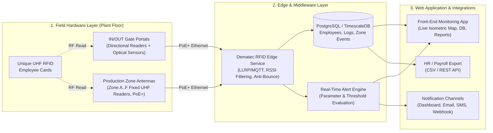

# Technical & Commercial Proposal — RFID Personnel Attendance & Real-Time Zone Monitoring System

**Prepared for:** Emiroglio (Production Facility)  
**Prepared by:** Dematec Vision  
**Date:** November 24, 2026  
**Document Reference:** DV-RFID-EMIR-2026-01  

---

## 1. Executive Summary

Dematec Vision proposes a complete, turnkey **UHF RFID Personnel Access, Attendance (IN/OUT), and Real-Time Production Zone Monitoring System** tailored for Emiroglio's manufacturing operations.

Each employee is issued a unique, tamper-resistant RFID badge. Directional RFID portals installed at facility entry/exit gates automatically capture IN/OUT timestamps without requiring manual badge swiping, while fixed industrial RFID antennas mounted across key production zones track each employee's real-time location. A unified web application provides an employee database, live isometric floor monitoring, automated attendance tracking, hours & zone analytics reports, and instant notifications whenever configurable employee parameters are exceeded.

---

## 2. Scope of Supply & Requirements Coverage

| Client Requirement | Proposed Dematec Vision Solution |
| :--- | :--- |
| **Unique RFID Card per Employee** | Passive UHF ISO 18000-6C (EPC Gen2) printed PVC ID cards with unique factory-locked TID + encoded EPC linked to each employee record (optional dual-frequency UHF + 13.56 MHz MIFARE for existing turnstiles/doors). |
| **RFID IN / OUT Attendance System** | Directional dual-antenna RFID Gate Portals at main personnel entrances/exits with optical/beam direction sensing to distinguish IN vs. OUT crossings accurately and prevent false reads. |
| **Production Zone RFID Antennas** | Fixed industrial IP65/IP67 PoE+ UHF RFID readers and circularly polarized antennas deployed across distinct production zones (Spinning/Weaving, Dyeing/Finishing, QC Lab, Warehouse, Maintenance, Restricted Areas). |
| **1. Employee Database** | Centralized CRUD web module storing Employee ID, full name, personal & contact details, department, role, assigned RFID Card UID, default production zone, authorized zones, and shift/parameter thresholds. |
| **2. IN / OUT Hours Monitoring** | Real-time attendance log recording shift clock-in, clock-out, net worked hours, late arrivals, early departures, and overtime accumulation with ERP/HR export support. |
| **3. Real-Time Position Monitoring** | Interactive isometric plant floor dashboard showing live headcount per zone, antenna health, individual employee pins, current vs. default position status, and dwell time in each zone. |
| **4. Hours & Position Reports** | Filterable analytics dashboards and printable/CSV-exportable reports covering worked hours vs. schedule, time spent in default vs. non-default zones, zone occupancy, and anomaly summaries. |
| **5. Automated Parameter Notifications** | Configurable rules engine dispatching real-time alerts (Web Dashboard, Email, SMS, Telegram/Webhook) when an employee is outside their default zone beyond threshold, enters a restricted zone, clocks in late, exceeds max shift hours, or is detected inside production without an IN scan. |

---

## 3. System Architecture

### Key Technical Highlights
- **Hands-Free Detection:** Passive UHF RFID cards require zero battery replacement (10+ year lifespan) and are read automatically at 2–6 meters depending on antenna tuning.
- **Anti-Bounce & Zone Arbitration:** Edge middleware applies RSSI signal strength smoothing and dwell-time hysteresis (e.g., 3–5 seconds) to prevent zone flickering near zone boundaries.
- **Offline Buffering:** Industrial fixed readers and the local edge server buffer events during network interruptions so zero IN/OUT records are lost.
- **Role-Based Access & GDPR Readiness:** Personal data access is restricted by user role (Admin, Plant Supervisor, HR, Security) with full audit trails and configurable data retention policies.

---

## 4. Proposed Bill of Materials (BOM) — Indicative Template

> *Note: Quantities and unit prices below are indicative templates to be finalized after the on-site RF site survey and final headcount / zone count confirmation.*

| # | Category | Item Description | Qty | Est. Unit (EUR) | Est. Total (EUR) |
| :-: | :--- | :--- | :-: | --: | --: |
| 1 | **RFID Cards** | Printable UHF EPC Gen2 PVC Employee Cards + Lanyard/Holder | 200 | €2.50 | €500 |
| 2 | **IN/OUT Portals** | Integrated Directional UHF RFID Gate Portal (4-Port Reader, 2 Antennas, Optical Beam, PoE+) | 2 | €3,200.00 | €6,400 |
| 3 | **Zone Readers** | Industrial 4-Port Fixed UHF RFID Reader (IP53/IP65, PoE+) | 3 | €1,450.00 | €4,350 |
| 4 | **Zone Antennas** | Circularly Polarized UHF Panel Antenna (8–9 dBi, IP67) + Low-Loss RF Cable & Mounting Bracket | 12 | €220.00 | €2,640 |
| 5 | **Card Enrollment** | Desktop USB UHF RFID Reader/Encoder (for HR Card Issuance) | 1 | €320.00 | €320 |
| 6 | **Network & Power** | Industrial Managed PoE+ Switch & Cabling Accessories | 1 | €950.00 | €950 |
| 7 | **Software Platform** | Dematec RFID Monitoring Suite (Employee DB, IN/OUT Module, Live Isometric Map, Reports, Alert Engine) | 1 | €8,500.00 | €8,500 |
| 8 | **Engineering Services** | RF Site Survey, Antenna Mounting & Calibration, Software Deployment, Testing & Staff Training | 1 | €3,800.00 | €3,800 |
| | | **Estimated Total (Excl. VAT)** | | | **€27,460** |

*Optional Annual SLA & Support Package (Software updates, remote diagnostics, priority hardware replacement): €2,400 / year.*

---

## 5. Alert Parameters & Rules Matrix

Each employee profile supports individual overrides on top of global defaults:

| Alert Type | Severity | Trigger Condition | Default Notification Channels |
| :--- | :--- | :--- | :--- |
| **Restricted Zone Entry** | Critical | Employee detected in an unauthorized zone (e.g., Chemical Storage / High-Voltage Room) | Live Dashboard Alarm, SMS, Email |
| **Out of Default Position** | Warning | Employee remains outside assigned default zone longer than configured limit (e.g., > 15 min) | Live Dashboard Toast, Supervisor Email |
| **Missing IN Gate Scan** | Critical | Employee detected by a production zone antenna without a valid IN portal scan | Live Dashboard Alarm, Security Alert |
| **Late Shift Arrival** | Info / Warning | First IN scan occurs after `Shift Start + Grace Period` (e.g., > 10 min) | HR / Supervisor Daily Feed & Email |
| **Overtime / Max Hours** | Warning | Active shift duration exceeds configured maximum (e.g., > 8.5 hours) | Supervisor Dashboard & Email |

---

## 6. Implementation Roadmap (6 Weeks)

1. **Week 1 — RF Site Survey & Zone Mapping:** Physical walk-through of Emiroglio production halls, metallic interference measurement, antenna placement blueprint, and final floor plan digitization.
2. **Week 2–3 — Hardware Procurement & Installation:** Mounting of IN/OUT gate portals and production zone antennas, PoE+ cabling, and desktop HR encoder setup.
3. **Week 4 — Software Deployment & Integration:** Installation of Dematec Monitoring App (on-premise server or private cloud), employee database import, RFID card encoding, and alert channel setup.
4. **Week 5 — RF Tuning & Pilot Run:** Antenna power/RSSI calibration per zone, shadow testing with pilot employee group, and accuracy validation (>99% gate capture, accurate zone handover).
5. **Week 6 — Go-Live & Training:** Operator, Supervisor, and HR training sessions, handover documentation, and production sign-off.

---

## 7. Interactive Front-End Prototype

An interactive front-end demonstration application has been prepared alongside this proposal to showcase the full user experience for Emiroglio:

- **Launch file:** `app/index.html` (opens directly in any modern browser — Chrome, Edge, or Firefox — with no installation required)
- **Demonstrates:**
  - Live isometric production floor map with animated real-time employee positioning & RFID antenna zones
  - Live IN/OUT RFID gate attendance monitor with interactive card scan simulator
  - Full Employee Database with add/edit/RFID card assignment and per-employee parameter thresholds
  - Interactive Hours & Zone Position Analytics with CSV export and printable PDF reports
  - Live Parameter Alert Engine with real-time toast alerts, acknowledge/resolve workflow, and channel dispatch log
  - Built-in Client Proposal & Interactive Cost Estimator tab

---

*Prepared by Dematec Vision — Industrial Automation, Vision & RFID Tracking Solutions.*
